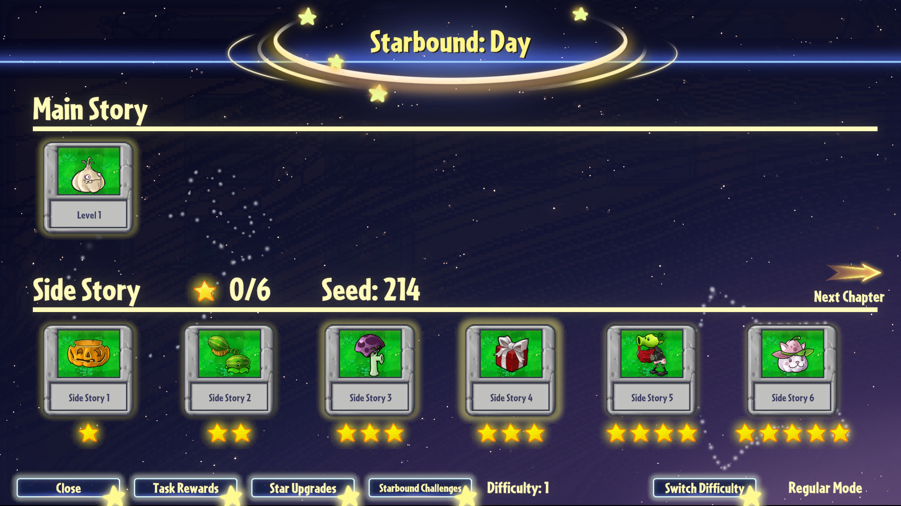
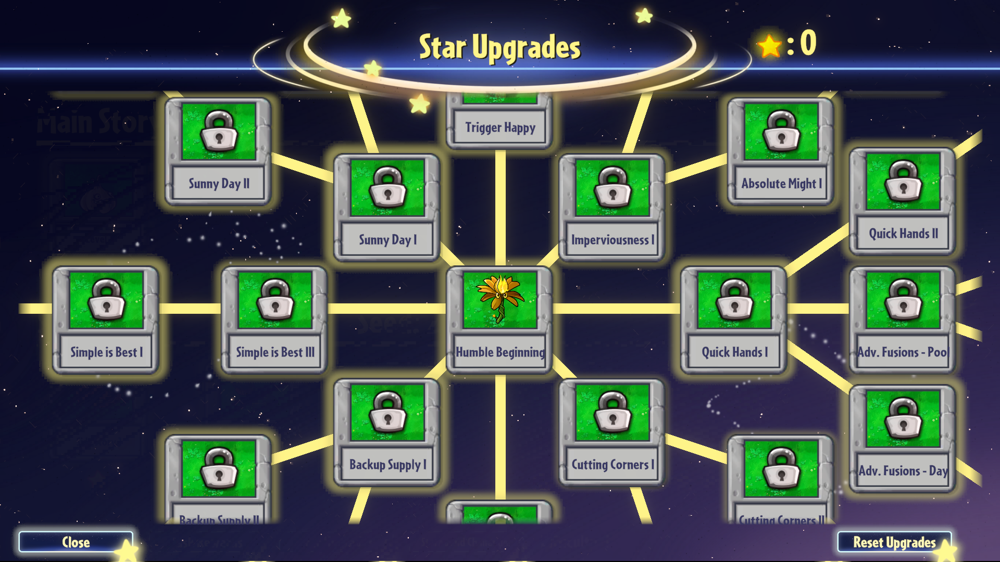

# PVZ Fusion StaRandomizer

A randomizer for Starbound Adventures gamemode of PVZ Fusion 4.1 with an optional built-in english translation.

 
 

**Download:** [Releases](https://github.com/starphene/pvz-fusion-starandomizer/releases) | **Latest release:** 1.0 | **Issues:** [issues](https://github.com/starphene/pvz-fusion-starandomizer/issues)

> Non-commercial fan mod.  No game files included. You need your own copy of the game.

---

## Screenshots

| Randomized level select | Reshuffled star tree |
|---|---|
|  |  |

---

## Features

**PVZ Fusion StaRando** unpredictably alters your playthrough of Starbound Adventures gamemode.

- **Plant card rewards shuffled and expanded.** Each level gives you a random plant reward. There's 57 in the pool, with complex safeguards in the seed generator in place to prevent unfun seeds.
- **Star upgrade tree remade, reshuffled and expanded.** Costs are randomized and 3 new star upgrades added.
- **Extra final-wave zombies**. Every final wave of 6th main story level, a couple of extra zombies come around to thrash your lawn. 
- **No need for external apps. Just run the modded game and play.** The seed you get is based on your profile name. 
- **Completely separate savefiles.** Your other saves are safe and sound from being overwritten.

**PvZFEnglish** is an English translation layer for the Chinese client, built partially by borrowing translation data from PVZF Blooms translation mod. See [Translation](#translation).

## Install

### Android

1. Install the game .apk, version 4.0 or younger. 4.1 and 4.0 at least. 
2. Install [PVZRH Android Launcher](https://github.com/ModPVZRH/PVZRH.Android.Launcher).
3. Download the modpack .zip from [Releases page](https://github.com/starphene/pvz-fusion-starandomizer/releases) onto your android device. There's one with translation bundled in, and one without. If your game is already translated, pick the one without.
4. Import the .zip as a modpack in the launcher.
5. Open the launcher and go to the modpacks screen. Use the import option there and pick the zip you copied over. 
6. Select the StaRandomizer modpack.
7. Go to the "games" screen and start the game with the chosen modpack. The first launch may take longer than usual.
8. The mod runs on a separate savefile. Press the settings button in bottom right corner of the title screen and double-press "Complete all Adventure levels", then enter and leave adventure mode to apply the unlocking of challenge tab.
9. Go to Challenges, then Starbound Adventures, and play! 

### PC

1. Install the game on your PC, version 4.0 or younger. 4.1 and 4.0 at least. 
2. Download the modpack .zip from [Releases page](https://github.com/starphene/pvz-fusion-starandomizer/releases) onto your PC. There's one with translation bundled in, and one without. If your game is already translated, pick the one without.
3. Unpack the .zip into the game folder with `PlantsVsZombiesRH.exe`.
4. Start `PlantsVsZombiesRH.exe`. The first launch may take longer than usual.
5. The mod runs on a separate savefile. Press the settings button in bottom right corner of the title screen and double-press "Complete all Adventure levels", then enter and leave adventure mode to apply the unlocking of challenge tab.
6. Go to Challenges, then Starbound Adventures, and play!

---

## Seeds and rerolling

To play a different seed, create a new profile and repeat step 6. The mod procedurally generates your seed based on your profile name. If you want a specific seed, input it directly into the name.

---

## Translation

Translation data comes from the PVZF-Translation project and is licensed CC BY-NC 4.0. See [Credits](#credits-and-licence).

---

## FAQ

<b>How can I choose my seed?</b>

Seeds are assigned per profile. Make a new profile, change its name and run it to change your seed. Renaming a profile doesn't alter a seed.

<b>Will this work on other game versions?</b>

It should.

<b>Is every seed winnable and not stupid?</b>

Hopefully. 

<b>Where do I report a bug, feedback, talk about the mod, etc etc?</b>

Sumbit any bugs in <a href="https://github.com/starphene/pvz-fusion-starandomizer/issues">issues</a>. I hang out in the <a href="https://discord.gg/DPAC5ZVJ8T">Blooms PVZF translation mod discord</a> and my discord tag is "starfene". Go to #fusion-modding and ping me. 

---

## Known issues

- **Star upgrade tree.** The star upgrade tree sometimes shows bogus strings under some conditions. I couldn't track the source of the bug. If you encounter it, open *gamefolder*/BepInEx/LogOutput.log and send it in in [issues](https://github.com/starphene/pvz-fusion-starandomizer/issues)

---

## Changelog

| Version | Notes |
|---|---|
| 1.0 | Release patch. |

---

## Credits and licence

- **Plants vs. Zombies Fusion:** 蓝飘飘fly's Team (original game).
- **Translation mod and data:** [Teyliu](https://github.com/Teyliu/PVZF-Translation[github) and [silvershadowkat](https://github.com/silvershadowkat/pvzf-android-translation).
- **BepInEx:** modding framework.
- **HarmonyX:** runtime patches.
- **Il2CppInterop**

Translation data is licensed under CC BY-NC 4.0, so this project is non-commercial.

---

## Disclaimer

This project was vibe-coded into existence. No AI images were used.

This is an unofficial fan project. It is not made by, affiliated with or endorsed by the game's developers, PopCap or Electronic Arts, or any of the projects from where the assets were borrowed. All game assets and trademarks belong to their owners. No game files are included. 

Registered under Unilicense. 